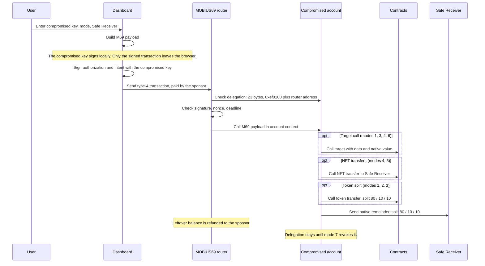
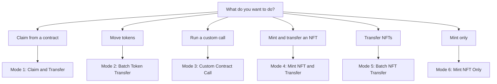

# MOBIUS69

**Recover a compromised or drained wallet.**

## The problem

Your wallet is compromised. A sweeper bot watches it around the clock. The moment anything valuable appears, or the moment gas arrives to move it, the bot takes it first.

That is why the obvious fix fails. Sending gas to the drained wallet just feeds the bot. The gas gets drained before your rescue transaction ever runs.

## The idea

Do not fund the drained wallet. Fund a separate wallet instead.

MOBIUS69 uses a Sponsor Wallet: a fresh wallet that pays the gas. You never send gas to the drained wallet, so the bot has nothing to steal, and it never gets the window it needs.

On EVM chains, the rescue runs as a single atomic transaction using EIP-7702. The drained wallet authorizes the rescue contract, and the rescue itself executes in the same transaction. Either everything moves at once, or nothing moves. There is no gap in between for the bot to slip into.

On Solana, you simulate first. You see exactly what will be swept before anything moves, then you execute.

## The flow

### EVM rescue

1. **Pick the chain.** Choose the network where the compromised wallet lives.
2. **Generate a Sponsor Wallet.** A fresh wallet is created in your browser. Fund it with a small amount of native gas. This is the only wallet that ever receives gas.
3. **Set up the rescue.** Enter the drained wallet's private key, the Safe Receiver that will receive your assets, and what you want to rescue: claim an airdrop, transfer or withdraw tokens, withdraw native, unstake, mint or transfer an NFT, run a custom call, or revoke.
4. **Execute.** The drained wallet authorizes the rescue contract, and the assets move to your Safe Receiver in one atomic transaction, paid for by the sponsor.

### Solana rescue

1. **Generate a Sponsor Wallet.** A fresh keypair is created in your browser. Fund it with a small amount of SOL for fees and rent.
2. **Set up the sweep.** Enter the drained wallet's private key and the safe wallet that will receive your assets.
3. **Simulate.** The tool shows you exactly what will be swept, batch by batch, before anything moves.
4. **Execute.** SOL, tokens, and NFTs move to your safe wallet. Core NFTs have their own dedicated sweep.

## How it works

This is what happens inside one EVM rescue transaction.

### The transaction

### Pick a mode

### Modes

| Mode | What it does | Target | Tokens | NFTs | Fee |
|---|---|---|---|---|---|
| 1 Claim & Transfer | Claim from a contract, then sweep | Claim contract | Claimed tokens | No | Tokens and native |
| 2 Batch Token Transfer | Sweep listed tokens | None | Listed tokens | No | Tokens and native |
| 3 Custom Contract Call | Any contract call, plus optional sweep | Any contract | Optional | Via calldata, any standard | Tokens and native |
| 4 Mint NFT & Transfer | Mint, then transfer one ERC721 | Mint contract | No | One ERC721 | Native leftover |
| 5 Batch NFT Transfer | Transfer listed ERC721 NFTs | None | No | Listed ERC721 | Native leftover |
| 6 Mint NFT Only | Mint from the account, no transfer | Mint contract | No | Minted, not transferred | Native leftover |

In mode 3, listing tokens without a Safe Receiver is rejected by the dashboard. In mode 5, only ERC721 is built in. ERC1155 and other standards go through mode 3 with hand-written calldata.

### What the contract checks

- Delegation is exactly 23 bytes: 0xef0100 plus the router address.
- Payload selector must be M69.
- Intent signature must recover to the compromised account.
- Nonce per account and sponsor increases before execution.
- Deadline must not have passed.
- No owner, no pause, no upgrade. The rules cannot change after deployment.

### Fee

Rescued tokens and native are split 80% to the Safe Receiver, 10% to the protocol, 10% to the referrer when one is set. Without a referrer, the protocol share is 20%. NFTs move in full. No fee is taken when the transaction reverts.

### After the rescue

Mode 7 is not a rescue. It removes the delegation: the account authorizes the zero address, the delegation is cleared, and the account becomes a normal wallet again. Run it after a successful rescue.

## Why you can trust it

**Your keys never leave your device.** Everything runs in your browser. Your keys sign locally and are never sent to a server.

**The drained wallet never receives gas.** The sponsor pays. The bot cannot eat your gas money, and on EVM chains the atomic transaction gives it no window to front-run you.

**You pay only if it works.** There is no upfront payment. A 20% fee is taken from rescued assets only when the rescue succeeds. NFT rescues are free.

**You see it before it happens.** On Solana, simulation shows the full sweep before execution. On EVM chains, the transaction is atomic: it either completes fully or not at all.

**No account, no custody.** There is no signup and no server holding your assets. You bring your own wallets, and the assets go straight to your Safe Receiver.

## Contracts

Every rescue contract is deployed on its chain. Check it yourself on the chain explorer before you trust it.

| Chain | Contract | Explorer |
|---|---|---|
| Ethereum Mainnet | `0x8A678DC077D7Aa7B9fAE76c4eCB712E3EF8d9821` | [Etherscan](https://etherscan.io/address/0x8A678DC077D7Aa7B9fAE76c4eCB712E3EF8d9821) |
| Base Mainnet | `0x640F92Da42a7F55Aa68c85dc05fA42C98734B285` | [BaseScan](https://basescan.org/address/0x640F92Da42a7F55Aa68c85dc05fA42C98734B285) |
| Arbitrum Mainnet | `0x5897BC5366193d87217B385eF1728eE0915C2974` | [Arbiscan](https://arbiscan.io/address/0x5897BC5366193d87217B385eF1728eE0915C2974) |
| BNB Smart Chain | `0xbacbB713E155ae7Dd1AddA1953591D0c9C987e8A` | [BscScan](https://bscscan.com/address/0xbacbB713E155ae7Dd1AddA1953591D0c9C987e8A) |
| Optimism Mainnet | `0xe6962f7a36f303225926A95F274B1DA0E9Ed1eAB` | [Etherscan](https://optimistic.etherscan.io/address/0xe6962f7a36f303225926A95F274B1DA0E9Ed1eAB) |
| Polygon Mainnet | `0x098576AcF1eD5Ea41543650E534bFD495e5f8819` | [PolygonScan](https://polygonscan.com/address/0x098576AcF1eD5Ea41543650E534bFD495e5f8819) |
| Monad Mainnet | `0xd41a059FA797Fe304301A08CbfEBe417d1903eAE` | [Monad Vision](https://monadvision.com/address/0xd41a059FA797Fe304301A08CbfEBe417d1903eAE) |
| Plume Mainnet | `0xd41a059FA797Fe304301A08CbfEBe417d1903eAE` | [Blockscout](https://explorer.plume.org/address/0xd41a059FA797Fe304301A08CbfEBe417d1903eAE) |
| MegaETH Mainnet | `0xd41a059FA797Fe304301A08CbfEBe417d1903eAE` | [MegaETH Etherscan](https://mega.etherscan.io/address/0xd41a059FA797Fe304301A08CbfEBe417d1903eAE) |
| Robinhood Mainnet | `0xd41a059FA797Fe304301A08CbfEBe417d1903eAE` | [Blockscout](https://robinhoodchain.blockscout.com/address/0xd41a059FA797Fe304301A08CbfEBe417d1903eAE) |
| HyperEVM Mainnet (Coming Soon) | `0xd41a059FA797Fe304301A08CbfEBe417d1903eAE` | [HyperEVMScan](https://hyperevmscan.io/address/0xd41a059FA797Fe304301A08CbfEBe417d1903eAE) |
| Sei EVM Mainnet | `0xd41a059FA797Fe304301A08CbfEBe417d1903eAE` | [Seiscan](https://seiscan.io/address/0xd41a059FA797Fe304301A08CbfEBe417d1903eAE) |
| Ink Mainnet | `0xCe99d5356E56887aa813641679b055135e67FcAa` | [Ink Explorer](https://explorer.inkonchain.com/address/0xCe99d5356E56887aa813641679b055135e67FcAa) |
| Unichain Mainnet | `0x2959da4e87C247c64C2f8A568Cb4c5b00D8915A3` | [Uniscan](https://uniscan.xyz/address/0x2959da4e87C247c64C2f8A568Cb4c5b00D8915A3) |
| Berachain Mainnet | `0xd41a059FA797Fe304301A08CbfEBe417d1903eAE` | [Berascan](https://berascan.com/address/0xd41a059FA797Fe304301A08CbfEBe417d1903eAE) |
| Plasma Mainnet | `0xd41a059FA797Fe304301A08CbfEBe417d1903eAE` | [PlasmaScan](https://plasmascan.to/address/0xd41a059FA797Fe304301A08CbfEBe417d1903eAE) |
| Ethereum Sepolia | `0x8e19AECFf86d66D6a0F2d74c710d78B2bEc5c55f` | [Etherscan](https://sepolia.etherscan.io/address/0x8e19AECFf86d66D6a0F2d74c710d78B2bEc5c55f) |
| Fraxtal Mainnet | `0x780d78814789482D62E289E466701f7a6c427C3a` | [Fraxscan](https://fraxscan.com/address/0x780d78814789482D62E289E466701f7a6c427C3a) |
| Sonic Mainnet | `0xd41a059FA797Fe304301A08CbfEBe417d1903eAE` | [SonicScan](https://sonicscan.org/address/0xd41a059FA797Fe304301A08CbfEBe417d1903eAE) |
| Gravity Alpha Mainnet | `0x54385172623cb9c37ee3d5799D03bbed62829eCD` | [Gravity Explorer](https://explorer.gravity.xyz/address/0x54385172623cb9c37ee3d5799D03bbed62829eCD) |
| X Layer Mainnet | `0x838014b14F71f97E517783825Db80e9eEc492237` | [OKLink](https://www.oklink.com/xlayer/address/0x838014b14F71f97E517783825Db80e9eEc492237) |
| Linea Mainnet | `0xd41a059FA797Fe304301A08CbfEBe417d1903eAE` | [LineaScan](https://lineascan.build/address/0xd41a059FA797Fe304301A08CbfEBe417d1903eAE) |
| Gnosis Mainnet | `0xd41a059FA797Fe304301A08CbfEBe417d1903eAE` | [GnosisScan](https://gnosisscan.io/address/0xd41a059FA797Fe304301A08CbfEBe417d1903eAE) |
| Mantle Mainnet | `0x1Ce67C484b245326f57BE4a79893db22af13bc5A` | [MantleScan](https://mantlescan.xyz/address/0x1Ce67C484b245326f57BE4a79893db22af13bc5A) |
| Soneium Mainnet | `0x073ca6F063562EAc7B86d193F68C0DD81817A465` | [Blockscout](https://soneium.blockscout.com/address/0x073ca6F063562EAc7B86d193F68C0DD81817A465) |
| Core Mainnet (Coming Soon) | Not deployed yet | [Core Scan](https://scan.coredao.org) |

HyperEVM has a deployed contract but the tool does not support it yet. Core has no contract deployed yet, so its link goes to the explorer homepage.

## Coverage

- 26+ EVM chains, plus Solana.
- Interface in Indonesian and English.
- Fee: 20% of rescued tokens or native, only on success. NFT rescues: 0%.

## Links

- Website: https://mobius69.xyz
- Docs: https://mobius69.xyz/docs
- Partner program: https://mobius69.xyz/partner
- Telegram: https://t.me/mobius69xyz
- X: https://x.com/mobius69xyz
